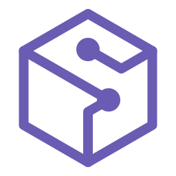
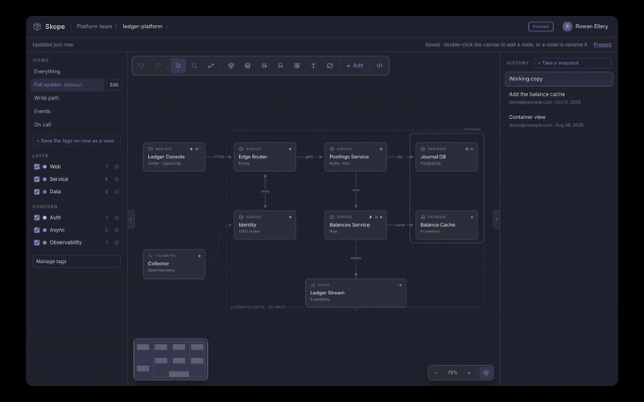

<picture>
  <source media="(prefers-color-scheme: dark)" srcset="docs/brand/daidal-mark-dark.svg">
  
</picture>

# Daidal

**The architecture diagram that stays true.** Typed nodes, tags, views and boundaries instead of loose shapes; a
small YAML/JSON format an AI can read and write; and, with the planned C4 work, levels that link to each other and
tell you when they disagree.



<sub>[The same tour as a video](docs/demo/tour.mp4) · [C4 drill-down, in 35 seconds](docs/demo/c4.gif) · [how they are recorded](docs/demo.md)</sub>

Say it *DYE-dal* — after Daidalos, the architect who could still find his way out of the labyrinth.

> **Status:** source-available, early. The hosted instance is invite-only while sign-in moves off Cloudflare
> Access. Self-hosting works today on a Cloudflare account. The name changed from *Skope* on 2026-11-08. The hosted
> site's address and the Cloudflare Worker and D1 database names still say `skope`; files saved before the rename
> still open and import.

<!-- TODO: hero GIF — a diagram being edited, then Claude adding a node through MCP. docs/media/hero.gif -->

## What it does

- **Opinionated diagrams.** Services, databases, queues, people, AI agents and your own workspace types; connections
  with labels, arrows and routes; containers that carry what sits inside them; tags that colour-code; views that show
  a slice. See [`docs/features.md`](docs/features.md) for the full editor.
- **History and lineage.** Snapshots with descriptions; copy a diagram as a duplicate or as a *follower* that reviews
  its lead's changes one by one.
- **Workspaces.** Personal and shared, with members, import/export as a backup file, and per-workspace node types.
- **AI through MCP.** `/mcp` exposes the same API the editor uses, under the same rules, so Claude (or any MCP
  client) lists, reads, creates and edits diagrams as you. [`docs/mcp.md`](docs/mcp.md).
- **Coming next:** diagram *kinds* that change behaviour — C4 drill-down between levels, one identity per element
  across levels, consistency checks, and a skill so your own AI can draw the diagrams from a repository.
  [`docs/superpowers/specs/2026-11-05-daidal-kinds-c4-and-repo-aware-ai.md`](docs/superpowers/specs/2026-11-05-daidal-kinds-c4-and-repo-aware-ai.md).

## Connect an AI

With a personal access token from the app (your initial → **AI access**):

```sh
claude mcp add --transport http daidal https://<your-site>/mcp --header "Authorization: Bearer skt_…"
```

Online, with Cloudflare Access's Managed OAuth on, clients sign in as you instead. Details and the tool list:
[`docs/mcp.md`](docs/mcp.md).

## Run it locally

```sh
npm ci && npm ci --prefix app
npx wrangler dev --var DEV_USER_EMAIL:you@example.com
```

Open http://localhost:8787 — signed in as that email, with a local SQLite database, no Cloudflare account needed.

## Self-host on Cloudflare

Daidal is one Worker, one D1 database and Cloudflare Access in front. Roughly:

1. `npx wrangler d1 create skope` and note the `database_id`.
2. In Cloudflare Zero Trust, add a self-hosted Access application for your hostname, with a policy allowing the people
   who should sign in; copy its **AUD** tag.
3. Set `routes[0].pattern` in `wrangler.jsonc` to your hostname, then generate the deploy config and deploy:
   ```sh
   PROD_D1_ID=<database_id> PROD_ACCESS_AUD=<aud> node scripts/prod-config.mjs
   npx wrangler d1 migrations apply skope --remote -c wrangler.prod.jsonc
   npx wrangler deploy -c wrangler.prod.jsonc --secrets-file wrangler.prod.secrets.json
   ```
4. For MCP clients online, turn on Managed OAuth for the Access application ([`docs/mcp.md`](docs/mcp.md)).

The GitHub Actions workflow in `.github/workflows/deploy.yml` does the same on every push to `main`, with the ids
and tokens in repository environments; [`docs/stage.md`](docs/stage.md) walks through the one-time setup, including a
shared stage site for pull requests.

Running it on the Workers Free plan is fine for a team; Cloudflare Access is free for up to 50 users on your own
account. The security model, limits and what is stored about people are in [`docs/security.md`](docs/security.md).

## Repository layout

| Path | What |
|---|---|
| `worker/` | The Cloudflare Worker: API, auth, limits, MCP server, tests |
| `app/` | The SvelteKit editor, served under `/app` |
| `packages/core/` | The shared core: the document types, scene model, SVG renderer, config and edits (no DOM, no dependencies), used by the app and the Worker |
| `migrations/` | D1 schema |
| `docs/` | MCP, security, stage, and design specs under `docs/superpowers/` |
| `e2e/`, `docs-shots/` | Playwright end-to-end tests and documentation screenshots |
| `stage/`, `scripts/` | Stage seed data and the config scripts CI uses |

## Contributing

Issues and pull requests welcome — [`CONTRIBUTING.md`](CONTRIBUTING.md) has the setup, the CLA note and what
merges easily. Security problems go through private vulnerability reporting ([`SECURITY.md`](SECURITY.md)).

## License and trademarks

Source-available under the **Functional Source License, version 1.1, ALv2 Future License**
([`LICENSE.md`](LICENSE.md)): use it, self-host it, change it, contribute to it; don't offer it as a competing hosted
product. Each version becomes Apache-2.0 two years after its release.

*Daidal* and the Daidal logo are trademarks of Violabs Software LLC; forks need a different name
([`TRADEMARKS.md`](TRADEMARKS.md)).
